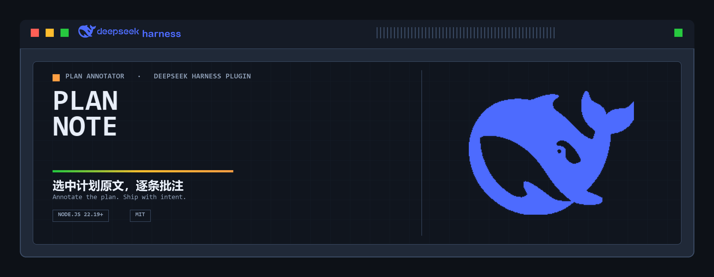
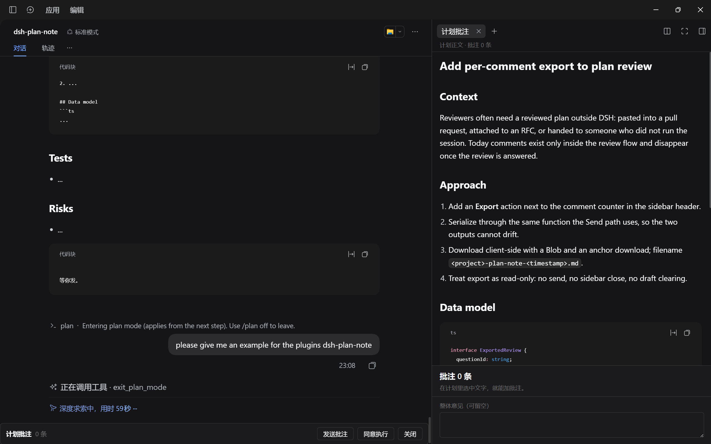
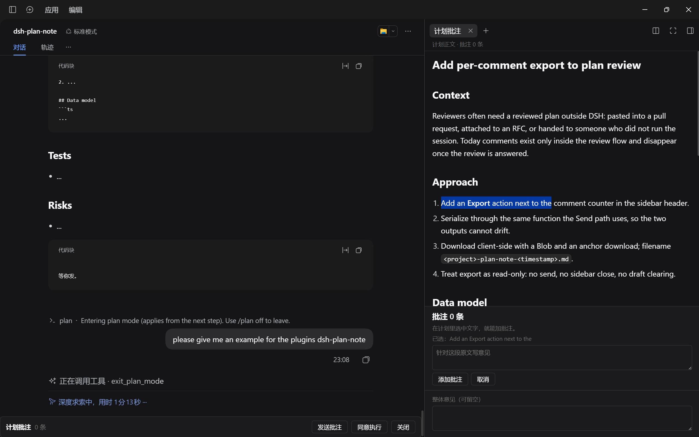
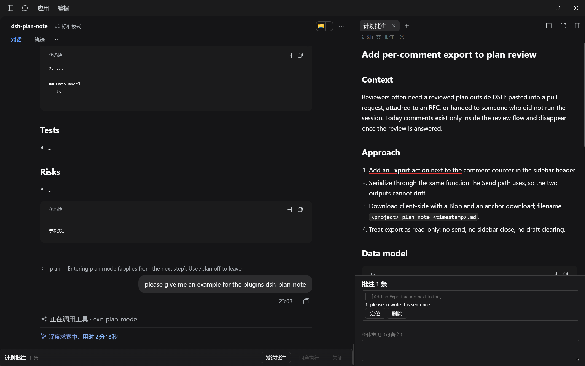
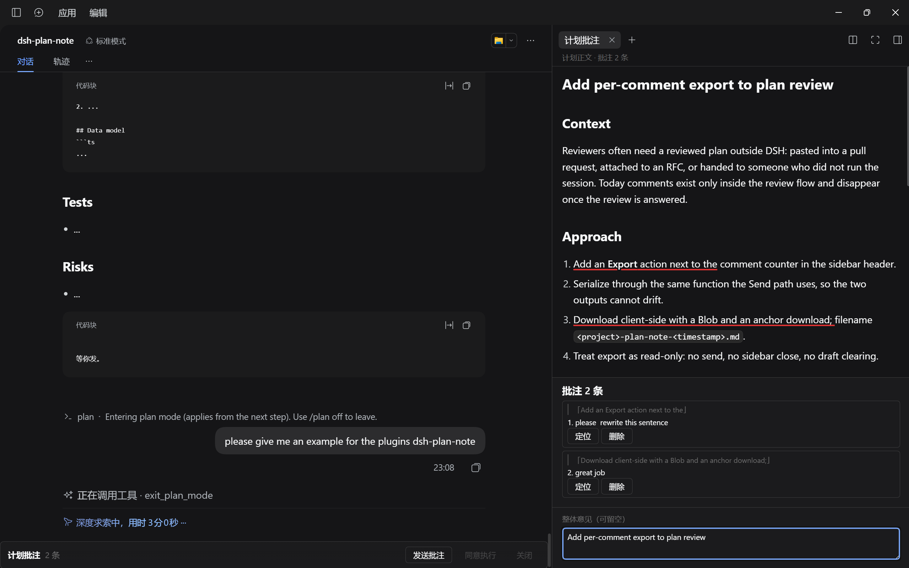

<div align="center">



# dsh-plan-note

**给 DeepSeek Harness 的计划评审加选区批注。**

选中一段、写一句意见、一次性发回——agent 留在计划模式里按批注改稿。

[](https://www.npmjs.com/package/dsh-plan-note)
[](LICENSE)
[](https://github.com/deepseek-ai/deepseek-harness)
[](https://github.com/0-0-user/dsh-plan-note/releases)

[**快速开始**](#quick-start) · [**演示**](#demo) · [**使用**](#usage) · [**限制**](#limits) · [English](README.md)

</div>

---

<a id="intro"></a>


DSH 原生的计划评审只有两个按钮：**同意** 或 **要求修改**。当一个计划有三五处互不相关的问题时，「改一下第三步」这种话说不清指的是哪一句。

`dsh-plan-note` 让每条意见都钉在对应的原文上，最后汇总成一份结构化反馈发回去。灵感来自 Claude Code 计划评审里的 *Add comment*。

<a id="demo"></a>


### 1. 具体演示



<a id="demo-select"></a>

### 2. 光标选取

在计划正文里拖选任意一段，底部就会弹出批注输入框。



<a id="demo-comment"></a>

### 3. 添加局部批注

写意见、点「添加批注」，这条批注就钉在了刚才那段原文上。此时「同意执行」和「关闭」会自动变灰。



<a id="demo-multi"></a>

### 4. 多条批注与全局批注

可以继续加任意多条批注，底部的「整体意见」用来写不针对某一段的总体反馈。



<a id="index"></a>


<table>
<tr>
<td width="54%" valign="top">

<table>
<tr><td><a href="#demo">演示示例</a></td></tr>
<tr><td><a href="#features">主要能力</a></td></tr>
<tr><td><a href="#use-cases">适用场景</a></td></tr>
<tr><td><a href="#quick-start">快速开始</a></td></tr>
<tr><td><a href="#usage">使用</a></td></tr>
<tr><td><a href="#limits">兼容与限制</a></td></tr>
<tr><td><a href="#dev">开发</a></td></tr>
<tr><td><a href="#thanks">致谢</a></td></tr>
<tr><td><a href="#feedback">反馈</a></td></tr>
</table>

</td>
<td width="46%" align="center" valign="middle">


</td>
</tr>
</table>

<a id="features"></a>


| | |
|---|---|
| **锚定批注** | 在任意段落上拖选，引用原文随批注保存并显示在列表里 |
| **多条共存** | 想写几条写几条，能定位、能删除重写 |
| **一次提交** | 全部合并成一段 Markdown，走 DSH 自己的提问通道回传 |
| **侧栏布局** | 计划放右侧栏，对话框只留一条窄操作条 |
| **草稿保护** | 未发送的批注刷新不丢；有未发送反馈时禁止批准 |
| **跟随主题** | 配色、边框、字号继承宿主；计划用宿主自己的 Markdown 渲染器 |

<a id="use-cases"></a>


- 多步骤实施方案：动手写代码之前，需要把好几处细节先定下来。
- 迁移、接口变更、灰度发布：兼容性、回滚条件、推进顺序各需要一条意见。
- 任何「还行」和「不行」两个答案不够用的评审。

<a id="quick-start"></a>


需要 DSH 0.2.x 的 Web 客户端。三条路选一条。

**npm（推荐）**

```bash
dsh plugin --profile <profile> add dsh-plan-note
```

**Release 附件**

```bash
dsh plugin --profile <profile> add https://github.com/0-0-user/dsh-plan-note/releases/download/v0.1.1/dsh-plan-note-0.1.1.tgz
```

**让 agent 装**

```text
帮我装一下 dsh-plan-note 插件，装完重启 DSH：
1. 先找出我正在用的 DSH profile（在 ~/.dsh/profiles 下的目录名）。
2. 执行：dsh plugin --profile <那个 profile> add dsh-plan-note
3. 确认插件列表里出现 dsh-plan-note 0.1.1。
如果看不出我用的是哪个 profile，直接问我。
```

安装后重启 DSH（或硬刷新网页端）。

<a id="usage"></a>


### 完整一轮

1. 输入 `/plan` 进入计划模式
2. 描述任务，agent 提交计划，DSH 弹出评审
3. 计划出现在右侧栏的「计划批注」标签页，对话框显示窄条
4. 选中一句话、一段、一个列表项或一行代码
5. 写意见，点「添加批注」
6. 想改几处就重复几次
7. 需要的话在底部写「整体意见」
8. 点「发送批注」，侧栏关闭，agent 收到反馈

### 发送之后

- agent 读到引用原文和你的意见，按它改计划
- 计划模式仍然开着，它会提交**新一版计划**给你再审一轮
- 上一轮的批注清空，新计划从空列表开始

### 三个按钮

| 按钮 | 作用 | 什么时候可点 |
|---|---|---|
| 发送批注 | 把批注和整体意见作为一份反馈提交 | 始终可点 |
| 同意执行 | 直接批准计划，退出计划模式 | 没有未发送批注时 |
| 关闭 | 退出评审，回到普通输入框 | 没有未发送批注时 |

### 边界情况

- 跨加粗或链接的选区发送后可能没有高亮，批注文字不会丢
- 刷新页面不丢同一轮未发送的批注
- 切换会话时评审仍可回答，切回来插件重新接管
- 带着批注点同意会被拒绝，要先发出去或删掉

### agent 收到的内容

```markdown
## 计划批注（2 条）

1. 原文：「……」
   意见：……

2. 原文：「……」
   意见：……

## 整体意见
……
```

<a id="limits"></a>


- 依赖 DSH **0.2.2-rc.1** 的 `conversation.composer` 与 `sidebar.right.pane.tab`，内核升级后可能失效
- 只在 Web 客户端可用，没有终端界面
- 跨加粗或链接的选区可能定位不到高亮，批注内容不会丢
- 计划按 Markdown 渲染，批注锚定的是渲染后的文字

<a id="dev"></a>


纯 JavaScript，无构建步骤。

```
lib/client.js           浏览器端 bundle（ModuleLoader 约定）
lib/index.js            空的宿主半身
cordis.patch.yml        一行 loader 条目
tools/make_hero.py      生成 docs/hero.png
tools/make_sections.py  生成章节横幅
docs/                   横幅、鲸鱼标与演示截图
```

欢迎提 issue 和 PR，请保持 bundle 无依赖。

<a id="thanks"></a>


- [Claude Code](https://www.anthropic.com/claude-code)——本插件的 *Add comment* 交互灵感来源
- [DeepSeek Harness](https://github.com/deepseek-ai/deepseek-harness)——插件平台与其 slot API
- 鲸鱼标属于 DeepSeek；横幅是围绕它做的粉丝构图

<a id="feedback"></a>


欢迎各路大神提供意见建议。

- GitHub Issue：<https://github.com/0-0-user/dsh-plan-note/issues>
- 小红书：1551112051
- Bilibili：1615793632

具体演示将同步发布在这两个平台上。

---

<sub>粉丝作品，与 DeepSeek、Anthropic 官方无关，也未获其背书。相关名称归各自所有者。</sub>
